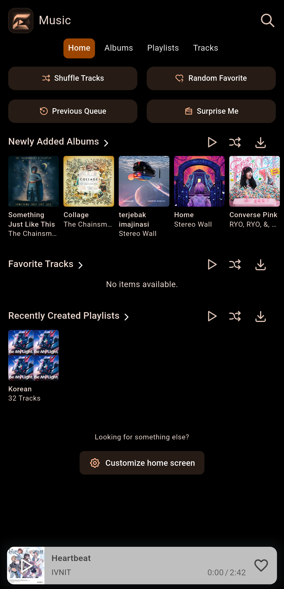
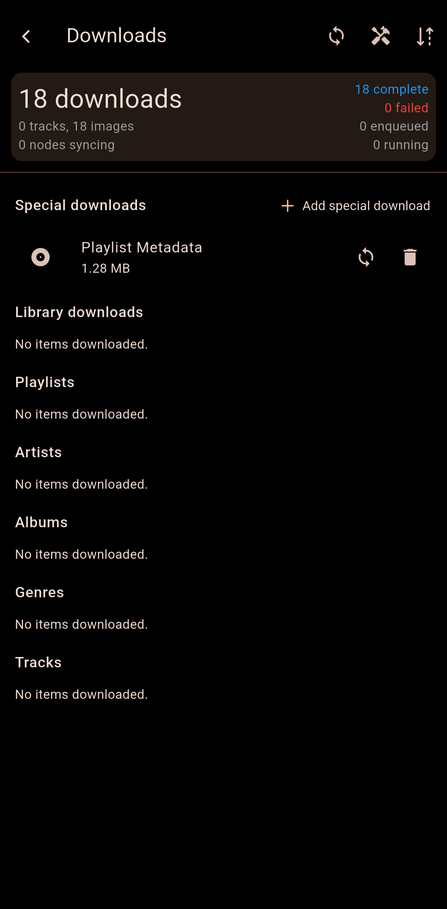

# Extify

Extify is a customized build of the open-source [Finamp](https://github.com/finamp-app/finamp) music client for [Jellyfin](https://jellyfin.org). It streams the music you host on your own Jellyfin server, plays it in the background, and can download it for offline listening. This fork adds Extify branding, a simplified login flow, and friendlier connection error messages.

> [!IMPORTANT]
> Extify is a **client**. It ships no music and only talks to the Jellyfin server you configure. You need your own Jellyfin server (or access to one) for the app to be usable at all.

## At a glance

| Item | Value | Source of truth |
| --- | --- | --- |
| Application name | Extify | `android/app/build.gradle` (`resValue "string", "app_name"`), `lib/main.dart` |
| Android application ID (release) | `com.expuz.extify` | `android/app/build.gradle` |
| Android application ID (debug) | `com.expuz.extify.debug` | `android/app/build.gradle` (`applicationIdSuffix '.debug'`) |
| Version | `1.0.1+201` (versionName `1.0.1`, versionCode `201`) | `pubspec.yaml` |
| Dart package name | `finamp` (unchanged from upstream) | `pubspec.yaml` |
| Dart SDK constraint | `^3.9.0` | `pubspec.yaml` |
| Android SDK levels | min 24, target 36, compile 36 | built APK manifest, `android/app/build.gradle` |
| Android ABIs | `arm64-v8a`, `armeabi-v7a`, `x86_64` | built APK |
| Languages | English (`en`), Indonesian (`id`) | `lib/utils/supported_locales.dart` |
| Upstream project | Finamp, licensed MPL-2.0 | see [License](#license) |

Note on identifiers: only the *installed* application ID was changed to `com.expuz.extify`. The Android `namespace`, the Kotlin packages, the MethodChannel names shared with Dart, and the notification channel ID are compile-time/internal identifiers and still use the upstream `com.unicornsonlsd.finamp` values. They do not affect the app's installed identity.

## Features currently implemented

Feature presence was verified by inspecting the project source. Runtime behaviour depends on your server and device; see [Status](#status-and-what-has-been-verified).

**Playback**

- Streaming directly from a Jellyfin server.
- Background playback with a media notification and lock-screen / notification controls (`audio_service`, an Android foreground service of type `mediaPlayback`, and the `WAKE_LOCK` permission).
- Gapless playback, a reorderable playback queue, shuffle and repeat, and a sleep timer.
- Volume normalization (ReplayGain).
- Optional transcoding, configurable per network type (`lib/screens/transcoding_settings_screen.dart`, `lib/screens/network_settings_screen.dart`).
- Lyrics (time-synced when your server provides them): `lib/screens/lyrics_screen.dart`.
- Android Auto (`lib/services/android_auto_helper.dart`, `android/app/src/main/res/xml/automotive_app_desc.xml`).
- Apple CarPlay on iOS (`lib/services/carplay_helper.dart`), and Windows System Media Transport Controls (`lib/services/audio_service_smtc.dart`).
- Discord Rich Presence (`lib/services/discord_rpc.dart`).

**Library and offline**

- Browse by album, artist, genre, playlist, and favourites; search; customisable home sections.
- Download music for offline playback, with configurable download locations (`lib/services/downloads_service.dart`).
- Local playback history and optional integration with the Jellyfin [Playback Reporting](https://jellyfin.org/docs/general/server/plugins/#playback-reporting) plugin.

**Appearance and settings**

- Light and dark themes with dynamic colours derived from the current album art and the system theme (`dynamic_color`, `palette_generator`).
- Custom accent colours and theme modes (`lib/services/theme_provider.dart`).
- Language selection limited to English and Indonesian (`lib/components/LanguageSelectionScreen/`).
- A logs screen with export, and a full settings tree.

**Login (Extify-specific)**

- **Simplified login flow**: the upstream server-selection and account-selection steps are skipped, and the login form authenticates directly against the Jellyfin server configured in the build.
- **Classified error reporting** (`lib/services/app_error_classifier.dart`): no internet connection, incorrect username or password, unable to connect to server, server temporarily unavailable, and a generic fallback. Each is presented with a localised message and a "Try again" action.
- Sessions are persisted on device and can be signed out from the settings.

## Screenshots

| Login | Home / Library | Now Playing | Downloads |
| :---: | :---: | :---: | :---: |
|  |  |  |  |

## Supported platforms and requirements

| Platform | Project files | Status |
| --- | --- | --- |
| Android | `android/` | **Primary target.** Rebranded (`com.expuz.extify`, label "Extify"), build verified in this repository. |
| iOS | `ios/` | Runner project present and buildable in principle, but `CFBundleDisplayName` is still `Finamp` and the bundle identifier is still the upstream value. Not customised for Extify; requires macOS, Xcode, and Apple signing. Treat as **unsupported** until branded and tested. |
| Linux | `linux/` | Desktop target inherited from upstream: `BINARY_NAME` is `finamp` and `APPLICATION_ID` is `com.unicornsonlsd.finamp`. **Not rebranded**; treat as upstream/unsupported. |
| Windows | `windows/` | Desktop target inherited from upstream: product name, description, and company still read `Finamp` / `com.unicornsonlsd`. **Not rebranded**; treat as upstream/unsupported. |
| macOS | `macos/` | Desktop target inherited from upstream: `PRODUCT_NAME` is `Finamp` and `PRODUCT_BUNDLE_IDENTIFIER` is `com.unicornsonlsd.finamp`. **Not rebranded**; treat as upstream/unsupported. |
| Web | none | No `web/` directory is configured. |

`.github/workflows/build.yml` attempts Android, iOS, Linux, and Windows builds. A CI job attempting to build a platform is **not** a statement that the platform is supported, branded, or tested — the four jobs are the upstream Finamp pipeline and still use upstream artifact names (`finamp-android-debug.apk`, etc.).

**To run Extify you need:**

- An Android device or emulator running Android 7.0 (API 24) or newer, with one of the bundled ABIs (`arm64-v8a`, `armeabi-v7a`, or `x86_64`).
- Network access from the device to your Jellyfin server. HTTPS is strongly recommended.
- A Jellyfin user account (username and password) on that server.

**Android permissions declared by the app** (`android/app/src/main/AndroidManifest.xml`): `INTERNET`, `WAKE_LOCK`, `FOREGROUND_SERVICE`, `FOREGROUND_SERVICE_MEDIA_PLAYBACK`, `READ_EXTERNAL_STORAGE`, `WRITE_EXTERNAL_STORAGE`, `VIBRATE`.

## Getting started

```powershell
# 1. Clone the repository
git clone https://github.com/Expuz66/extify-project.git D:\extify-project
Set-Location D:\extify-project

# 2. Fetch dependencies (requires Git and network access to github.com)
flutter pub get

# 3. See available devices
flutter devices

# 4. Run on a device or emulator
flutter run -d <device-id>
```

`flutter pub get` needs to reach `pub.dev` **and** GitHub, because several dependencies are pinned to Git revisions (for example the forked `just_audio`, `media_kit`, `audio_service`, and `isar` packages listed in `pubspec.yaml`).

## Development environment setup

1. **Flutter (stable channel).** This revision was built with Flutter `3.47.7` / Dart `3.13.5`; the SDK constraint is `^3.9.0`. Install Flutter, then confirm:

   ```powershell
   flutter --version
   flutter doctor
   ```

2. **Java.** A JDK is required for the Android build. The Gradle configuration targets Java 17 (`sourceCompatibility`/`targetCompatibility`/`jvmTarget = 17`), CI uses Java 17, and this revision was built locally with Eclipse Temurin JDK 21. Set `JAVA_HOME` to your JDK installation.

3. **Android SDK.** Install platform 36 and build-tools 36.0.0 (the root Gradle file pins `buildToolsVersion "36.0.0"`). Point `android/local.properties` at your SDK and Flutter install:

   ```properties
   sdk.dir=C:\\Users\\<you>\\AppData\\Local\\Android\\sdk
   flutter.sdk=C:\\develop\\flutter
   ```

   `android/local.properties` is machine-specific and gitignored — never commit it.

4. **Toolchain versions used by this project** (`android/settings.gradle`, `android/gradle/wrapper/gradle-wrapper.properties`): Android Gradle Plugin `8.13.2`, Kotlin `2.3.21`, Gradle `8.14.4`.

5. **Code generation.** Several packages rely on generated code. Run this after changing settings, models, or the Jellyfin API layer:

   ```powershell
   dart run build_runner build --delete-conflicting-outputs
   ```

6. **Native splash screens.** Regenerate after changing splash colours or assets:

   ```powershell
   dart run flutter_native_splash:create --path=flutter_native_splash.yaml
   ```

7. **Launcher icons.** Generated from `assets/icon/icon_combined.png` per the `flutter_launcher_icons` section of `pubspec.yaml`:

   ```powershell
   dart run flutter_launcher_icons
   ```

8. **Checks.**

   ```powershell
   dart format --line-length 120 lib test
   flutter analyze
   flutter test
   ```

   Integration tests live in `integration_test/test_cases.dart` and require a connected device or emulator.

See [CONTRIBUTING.md](CONTRIBUTING.md) for the upstream development notes that still apply (project structure, extending the Jellyfin API, adding settings, adding localized strings).

## How to build a debug APK

```powershell
flutter pub get
flutter build apk --debug
```

Output:

```text
build\app\outputs\flutter-apk\app-debug.apk
```

The debug build uses the application ID `com.expuz.extify.debug` and the label "Extify Debug", so it installs alongside a release build without conflicting.

To install it with `adb`:

```powershell
adb install -r build\app\outputs\flutter-apk\app-debug.apk
```

The `profile` variant (`flutter build apk --profile`) uses the ID suffix `.profile` and the label "Extify Profile".

## How to build a release APK, including signing requirements

Release builds **must be signed**. `android/app/build.gradle` reads the release keystore from `android/key.properties`; if that file is missing, the release build will not produce a signed APK.

### 1. Create a keystore (once)

```powershell
keytool -genkeypair -v `
  -keystore C:\Users\<you>\keystores\extify-release.jks `
  -keyalg RSA -keysize 2048 -validity 10000 `
  -alias extify
```

### 2. Create `android/key.properties`

```properties
# android/key.properties — NEVER commit this file (it is already gitignored)
storeFile=C:/Users/<you>/keystores/extify-release.jks
storePassword=<your-store-password>
keyAlias=extify
keyPassword=<your-key-password>
```

Use forward slashes in `storeFile`; the path is resolved by Gradle, and absolute paths avoid ambiguity. Optional keys `debugKeystoreFile`, `debugKeystorePassword`, `debugKeyAlias`, and `debugKeyPassword` may be added to sign debug builds with a shared keystore, but they are not required.

> [!WARNING]
> `android/key.properties` and `*.jks` are listed in `.gitignore`. Never commit your keystore or its passwords, and do not include them in build logs or issues.

### 3. Build

```powershell
flutter pub get

# Universal APK (all bundled ABIs in one file)
flutter build apk --release

# Or one APK per ABI (smaller downloads)
flutter build apk --release --split-per-abi

# Or an Android App Bundle for Google Play
flutter build appbundle --release
```

Outputs:

```text
build\app\outputs\flutter-apk\app-release.apk               # universal
build\app\outputs\flutter-apk\app-arm64-v8a-release.apk     # --split-per-abi
build\app\outputs\flutter-apk\app-armeabi-v7a-release.apk
build\app\outputs\flutter-apk\app-x86_64-release.apk
```

Flutter writes the App Bundle to `build\app\outputs\bundle\release\app-release.aab`.

The universal APK bundles native libraries for all three ABIs and is therefore much larger than a per-ABI split; prefer `--split-per-abi` (or the AAB) for distribution.

### 4. Installing over an existing install

Android refuses to replace an app that is signed with a different key, and refuses a downgrade of the version code. If installation fails after you change the signing key or switch between the universal and split APKs, uninstall the existing copy first — this deletes its logins, settings, and downloads:

```powershell
adb uninstall com.expuz.extify
```

## Jellyfin server configuration and authentication

Unlike upstream Finamp, **Extify does not ask you to type a server address**. The server is compiled into the build as a constant:

```dart
// lib/components/LoginScreen/login_flow.dart
const String extifyDefaultServerUrl = "https://stream.expuz-server.my.id";
```

Behaviour:

- Get Started takes you straight to the username/password form; the server-selection and account-selection pages exist in the source but are not reachable from this flow.
- Before authenticating, the shared Jellyfin API client's temporary base URL is pointed at `extifyDefaultServerUrl` (`JellyfinApiHelper.baseUrlTemp`).
- The server address is the only thing hard-coded. **No credentials or tokens are stored anywhere in this repository.** The username and password are entered by the user at runtime; the resulting Jellyfin session is stored on the device by the app's normal user/session mechanism.
- Connection failures are classified and shown as localised messages: "No internet connection", "Incorrect username or password", "Unable to connect to server", "Server temporarily unavailable", or a generic "Something went wrong".

### Pointing Extify at your own Jellyfin server

Change `extifyDefaultServerUrl` in `lib/components/LoginScreen/login_flow.dart` to your own address (no trailing slash or path), then rebuild. If you intend to distribute a build, make sure both the address and the branding are your own.

> [!NOTE]
> `https://stream.expuz-server.my.id` is the maintainer's own endpoint, not a public or shared service. Do not depend on it; forks and redistributed builds should replace it.

### Transport security

`android/app/src/main/res/xml/network_security_config.xml` trusts both system and **user-installed** certificates and permits cleartext (HTTP) traffic. This makes self-signed certificates and plain-HTTP servers usable, at the cost of weaker transport security. If you distribute Extify, review this before publishing — prefer HTTPS with a publicly trusted certificate.

## Supported languages

Two locales are exposed in the app (`lib/utils/supported_locales.dart`):

| Locale | Language | String file |
| --- | --- | --- |
| `en` | English | `lib/l10n/app_en.arb` (the template file) |
| `id` | Indonesian | `lib/l10n/app_id.arb` |

`List<Locale> extifySupportedLocales = <Locale>[Locale("en"), Locale("id")]` drives `MaterialApp.supportedLocales`, the locale resolution callback, and the language selection screen. Android's per-app language list (`android/app/src/main/res/xml/locales_config.xml`) declares the same two locales. Device languages outside this list fall back to English.

The other translation files in `lib/l10n/*.arb` are inherited from upstream Finamp and remain on disk, but they are **not** reachable from the language selector. To add a language, add its `.arb` file, add a `Locale` to `extifySupportedLocales`, and add a `<locale>` entry to `locales_config.xml`.

## Project structure

```text
extify-project/
├─ android/                 Android app (applicationId com.expuz.extify; namespace still upstream)
├─ assets/                  Icons, launcher art, splash sources, store badges
├─ fastlane/metadata/       Play Store listing metadata (inherited from upstream)
├─ images/                  Marketing/in-app images (inherited from upstream)
├─ integration_test/        Device/emulator integration tests
├─ ios/ linux/ macos/ windows/   Other platform targets (inherited, not rebranded)
├─ lib/
│  ├─ main.dart             App entry, MaterialApp setup, startup error screen
│  ├─ components/           Widgets, grouped by screen (incl. LoginScreen/)
│  ├─ screens/              Top-level screens (settings, player, lyrics, ...)
│  ├─ services/             API, playback, downloads, settings, error classification
│  ├─ menus/                Context menus
│  ├─ models/               Hive/Isar models and Jellyfin DTOs
│  ├─ l10n/                 .arb sources and generated localizations
│  ├─ utils/                Platform helpers and supported_locales.dart
│  └─ gen/                  Generated asset references
├─ test/                    Unit tests (error classifier, discovery parser, config invariants)
├─ tools/code_recap/        Helper scripts
├─ pubspec.yaml             Dependencies, assets, version, icon/splash/MSIX config
└─ LICENSE, PRIVACY.md, CONTRIBUTING.md
```

Key files for the Extify customisations:

| Concern | File |
| --- | --- |
| Fixed server address and simplified login entry | `lib/components/LoginScreen/login_flow.dart` |
| Login form and error display | `lib/components/LoginScreen/login_authentication_page.dart` |
| Error classification | `lib/services/app_error_classifier.dart` |
| Global snackbar/error presentation | `lib/components/global_snackbar.dart` |
| Supported locales | `lib/utils/supported_locales.dart` |
| Application ID, app label, signing | `android/app/build.gradle` |
| Config invariants test (fixed URL, en+id only) | `test/extify_config_invariants_test.dart` |

## Troubleshooting

**`flutter pub get` fails or hangs.** Several dependencies come from Git revisions on GitHub. Confirm you have Git installed and network access to both `pub.dev` and `github.com`, then retry.

**Android build stuck in `assembleDebug`.** Stop the build, run `flutter clean`, then `flutter pub get` and rebuild. See the "Android Debug Build stuck in 'assembleDebug'" section of [CONTRIBUTING.md](CONTRIBUTING.md) for the upstream notes.

**"Unclosed caches" errors on Windows.** This happens when the pub cache is on a different drive from the project. Either move the project, or point the pub cache to the same drive — for example `PUB_CACHE=D:\pub-cache`.

**`rustup not found` / Cargokit warnings.** Some desktop plugins (`flutter_discord_rpc`) are Rust-based and require Rust for *desktop* builds. On Android these warnings are harmless and do not block the build; installing Rust removes the message.

**NDK or build-tools version mismatch.** Gradle pins `buildToolsVersion "36.0.0"` and the platform is 36. Install the matching SDK components, or accept the SDK license prompts with `flutter doctor --android-licenses`.

**"App not installed" when installing a release APK.** The APK is signed with a different key than the installed copy, or its version code is lower. Uninstall the existing app (`adb uninstall com.expuz.extify`) and install again. Note that the universal APK has a lower version code than the `--split-per-abi` APKs, so mixing the two requires an uninstall.

**"Incorrect username or password" on a correct login.** This message is only shown when the server itself rejects the authentication request. Check that the account exists on the configured server and is not disabled. If you are signing in to a different server than the one compiled into the build, change `extifyDefaultServerUrl` and rebuild.

**"Unable to connect to server".** The address is unreachable from the device: check the DNS name, the port, whether the device is on a network that can reach the server, and whether the server's certificate is valid. The app permits cleartext HTTP and user-installed certificates, so certificate errors are not automatically hidden.

**"No internet connection".** The device has no usable network interface at all. This message is only shown when the app can positively determine that no connection exists; otherwise the real request outcome is used.

**Localizations behave oddly after switching branches.** Regenerate code with `dart run build_runner build --delete-conflicting-outputs` and, if needed, `flutter clean`.

## Privacy and security notes

- Extify collects no analytics or telemetry. As stated in [PRIVACY.md](PRIVACY.md), the app only talks to the Jellyfin server it is configured with, and data is stored on your device or on that server.
- No credentials, API tokens, keystores, or server passwords are stored in this repository. `android/key.properties`, `android/local.properties`, `*.jks`, and `build/` are gitignored.
- The user's Jellyfin password is used to obtain a session token; that session is stored on the device by the app's normal user/session mechanism. Session token handling is inherited from upstream Finamp — treat it as you would any credential.
- Android's backup rules (`android/app/src/main/res/xml/backup_rules*.xml`) and `android:allowBackup="true"` allow app data to be included in device backups. Review this if you handle sensitive servers.
- The network security config trusts user-installed CA certificates and permits cleartext traffic (see [Transport security](#transport-security)). This is convenient for self-hosted setups and self-signed certificates but weakens transport security; tighten it before distributing widely.
- This README intentionally documents configuration rather than publishing usable endpoints, and never includes account credentials.

## Credits and open-source acknowledgements

Extify is a **derivative work** of [Finamp](https://github.com/finamp-app/finamp), an open-source Jellyfin music player. It was not written from scratch. Substantially all of the playback engine, library browsing, downloads, settings, and localization originates in Finamp; the Extify changes are the branding, the simplified login flow, the localized error classification, and associated configuration.

Thanks are due to:

- The **Finamp contributors and maintainers** ([contributors graph](https://github.com/finamp-app/finamp/graphs/contributors)), whose work this project is built on. The Finamp name originates from [this Reddit thread](https://www.reddit.com/r/jellyfin/comments/hjxshn/jellyamp_crossplatform_desktop_music_player/fwqs5i0/).
- The **[Jellyfin](https://jellyfin.org)** project and its contributors, for the media server and API this client targets.
- The maintainers of the third-party Flutter and Dart packages used here, in particular `just_audio` (and the `LennartEnns/just_audio_fork` fork), `media_kit`, `audio_service` (the `finamp-app` fork), `isar` and `hive_ce`, `chopper`, `riverpod`, `dynamic_color`, `palette_generator`, `background_downloader`, `flutter_carplay`, `smtc_windows`, `dbus`, `flutter_native_splash`, and `flutter_launcher_icons`. The full dependency list, including pinned Git revisions, is in `pubspec.yaml`.

The in-app licences page (the `viewLicensesButtonLabel` entry in Settings, which calls Flutter's `showLicensePage`) lists the licences of the bundled third-party packages and shows the application name as "Extify".

## License

Two licence texts are relevant, and they are currently **not the same** — this is stated plainly because the difference should be reviewed before distributing builds.

1. **This repository's `LICENSE` file** contains the MIT License, `Copyright (c) 2026 ExpuzGG`.
2. **Upstream Finamp is licensed under the [Mozilla Public License 2.0](https://github.com/finamp-app/finamp/blob/main/LICENSE)**. This repository's own metadata still declares that: `assets/com.unicornsonlsd.finamp.metainfo.xml` contains `<project_license>MPL-2.0</project_license>`, and the `applicationLegalese` string in `lib/l10n/app_en.arb` still reads "Licensed with the Mozilla Public License 2.0."

Because Extify contains Finamp's source code, the upstream copyright notices and licence terms continue to apply to the upstream portions, independently of any licence applied to the Extify-specific modifications. The root `LICENSE` file currently does not include the upstream MPL-2.0 text or a notice that this is a derivative of Finamp; **review this before publishing or redistributing builds.** This README does not assert a licence for Extify and does not replace legal advice.

No existing licence file, notice, or attribution in this repository was modified or removed when this README was written.

## Appendix: dynamic theming on Linux (D-Bus)

The Linux build registers a session D-Bus service that can be used to update the accent colour without restarting the app. The service details below were verified in `lib/services/dbus_manager.dart`:

- Bus: session
- Destination: `com.unicornsonlsd.FinampSettings`
- Object path: `/com/unicornsonlsd/Finamp`
- Interface: `com.unicornsonlsd.Finamp`
- Methods: `updateAccentColor` (reload the system accent colour), `setAccentColor` (set an explicit colour)

```sh
gdbus call \
    --session \
    --dest 'com.unicornsonlsd.FinampSettings' \
    --object-path '/com/unicornsonlsd/Finamp' \
    --method 'com.unicornsonlsd.Finamp.updateAccentColor'

gdbus call \
    --session \
    --dest 'com.unicornsonlsd.FinampSettings' \
    --object-path '/com/unicornsonlsd/Finamp' \
    --method 'com.unicornsonlsd.Finamp.setAccentColor' \
    '#ff0000'
```

These names are inherited from upstream and still use the `com.unicornsonlsd` identifiers. This only applies to Linux builds.

## Status and what has been verified

- The Android configuration above was checked against `pubspec.yaml`, `android/app/build.gradle`, the Android manifest, the resources, and the built APK's manifest (application ID, label, version code, SDK levels, and bundled ABIs).
- Android debug and release APKs build successfully from this revision.
- `flutter test`, `dart format`, and `flutter analyze` are the project's verification commands; see [Development environment setup](#development-environment-setup).
- Music playback against a Jellyfin server has been reported working by the maintainer of this project. No device or emulator test run is recorded in this repository, so that report is not independently verified here. The iOS, Linux, Windows, and macOS targets have not been rebranded or verified.
